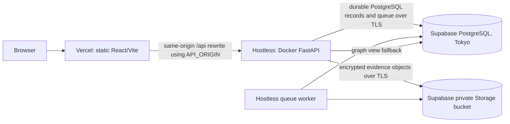

# No-card hosted deployment guide

This guide records the selected no-card deployment path and the exact setup still required. The owner authorized a backend-host change on 13 November 2026 after Render's account-specific signup flow required payment-card verification and a temporary USD 1 authorization. **Hostless is selected for a free, synthetic-data review deployment; it has not yet been connected or provisioned.** No provider secrets were read or copied, and no Supabase migration was run.

## Current state

| Component | Observed state | What this proves |
| --- | --- | --- |
| GitHub | Branch `codex/initial-platform` is pushed through [`d1797ff`](https://github.com/gaurvit06/RSIACDP/commit/d1797ff25e7bf1206cf15692de3b1588a333341a). | GitHub Actions run [43300545988](https://github.com/gaurvit06/RSIACDP/actions/runs/43300545988) completed all six jobs successfully: backend, frontend, Compose config, Compose E2E/recovery, web container, and operations scripts. This does not provision cloud services. |
| Vercel frontend | `https://rsiacdp-frontend.vercel.app/` responds HTTP 200. | Static frontend delivery only. `/api/health/live` still returns HTTP 404 because there is no backend origin configured. |
| Render backend | No service exists. The verified Render setup flow stopped at card verification. | Render remains unused; do not retry it under the no-card constraint. |
| Hostless backend | Not created or connected yet. | `hostless.yaml` prepares one API and one queue worker within the documented free resource ceiling. A project URL and protected environment values are still needed. |
| Supabase | Existing Free `rsiacdp` project is healthy in Tokyo (`ap-northeast-1`). | On 13 November, read-only SQL returned `NULL` for `to_regclass('public.alembic_version')` and 0 rows from `pg_catalog.pg_tables` in `public`; dashboard also showed “No migrations” and “No backups.” No migration or schema mutation occurred. The application schema is fresh as checked; recheck before first API startup. |

The platform is **not deployed end to end**. Do not submit real investigation evidence until the host's region, privacy terms, data-processing safeguards, backup/restore path, and hosted security checks have been reviewed. Use synthetic records while doing this setup.

## Why Hostless and what its free limits mean

Hostless's published docs support Docker apps, long-running workers, HTTPS, and Git deployments. Its current pricing material advertises a shared free allowance of 0.5 vCPU and 1 GiB RAM; its per-process free deduction is capped at 0.1 vCPU and 256 MiB RAM. The manifest therefore fixes the API to one 0.1-vCPU/256-MiB replica and one 0.1-vCPU/256-MiB queue worker. It provisions no Hostless database or persistent disk. Confirm the account's current allowance and estimate show **$0** before creating the app; stop if the UI asks for a card, credit, paid plan, or billable capacity. Hostless documents that a spending limit does not stop charges from already-running resources, so this manifest uses fixed single replicas rather than scaling above the included capacity. [Hostless free limits](https://docs.hostless.cloud/plans/free-tier) · [Hostless manifest reference](https://docs.hostless.cloud/app/hostlessfile) · [Hostless billing limits](https://docs.hostless.cloud/billing/costbreakdown)

These resource bounds are small. OCR, large PDFs, concurrency, and cold database connections may be slow or may exceed 256 MiB and restart a process. The local OCR and Compose E2E tests do not establish Hostless capacity. If hosted OCR fails at this limit, do not silently raise resources; the no-card constraint and the user-visible upload limits need a deliberate follow-up decision.

Hostless's publicly reviewed setup pages did not establish a deployment region, a data-processing agreement, or an independent security attestation for this project. Confirm those points with the provider before entering real personal information. Supabase remains in Tokyo while the backend's final region is unknown; do not claim regional residency or latency characteristics until verified. This small free deployment is for synthetic review only, not the sole system of record for real investigations.

## Architecture and data flow



- **PostgreSQL is authoritative.** The Hostless API and worker use the existing Supabase PostgreSQL database. Evidence records, audit history, corrections, deterministic links, and queued work remain in PostgreSQL.
- **Uploads remain private and encrypted.** The API uses the existing Supabase Storage adapter and application AES-GCM envelope with the bucket `private-evidence`; no Hostless local file or public object URL is configured. The bucket must remain private and allow encrypted `application/octet-stream` objects of at least 11 MiB.
- **The worker remains durable and separate.** Hostless runs `python -m app.worker` as one bounded worker process. Jobs continue to be represented in PostgreSQL and can be retried after process interruption according to the existing stale-job rules.
- **Graph view works from persisted PostgreSQL links.** `NEO4J_*` is intentionally unset. The API uses its PostgreSQL-derived graph fallback; Neo4j is an optional rebuildable projection, not the source of truth or product novelty.
- **Source checks remain conservative.** The local evidence corpus works without an LLM or external service. RDAP stays disabled until explicitly configured. I4C is not an assumed API and is not integrated here.
- **Vercel keeps browser requests same-origin.** `frontend/vercel.mjs` reads the non-secret Vercel project variable `API_ORIGIN` at request time and rewrites `/api/*` to the Hostless origin. This preserves the existing secure cookie and CSP design. Set the variable only after Hostless assigns and verifies the app URL. [Vercel programmatic project configuration](https://vercel.com/docs/project-configuration/vercel-ts) · [Vercel external rewrites](https://vercel.com/docs/routing/rewrites)
- **Vercel Hobby is personal/non-commercial.** Confirm the project's use fits the current plan terms; keep the generated `*.vercel.app` URL and do not start a paid trial. [Vercel Hobby plan](https://vercel.com/docs/plans/hobby) · [Vercel terms](https://vercel.com/legal/terms)

## Hostless configuration in the repository

The root `hostless.yaml` defines only:

1. A Docker API built from `backend/Dockerfile` with the backend directory as its build context. That image installs Tesseract and already reads Hostless's `PORT` environment variable.
2. One HTTP process at 0.1 vCPU/256 MiB, one replica, with `/health/live` as the liveness check.
3. One `python -m app.worker` process at 0.1 vCPU/256 MiB, one replica.

The manifest creates no database, volume, or secret values. Set the following in Hostless's protected app environment. Do not put secret values into GitHub, this guide, screenshots, or chat. [Hostless environment variables and secrets](https://docs.hostless.cloud/app/envvars) · [Hostless read-only filesystem](https://docs.hostless.cloud/app/filesystem)

| Variable | Value or source | Purpose |
| --- | --- | --- |
| `APP_ENV` | `production` | Enables production validation. |
| `DATABASE_URL` | Supabase **Session pooler** connection string, SQLAlchemy form `postgresql+psycopg://...?...sslmode=require` | PostgreSQL system of record. Use Supabase Connect; percent-encode reserved password characters. Do not use the transaction-pooler port 6543. [Supabase connection guide](https://supabase.com/docs/guides/database/connecting-to-postgres) |
| `SUPABASE_URL` | Existing Supabase project HTTPS origin | Storage API origin. |
| `SUPABASE_SERVICE_ROLE_KEY` | Existing Supabase service-role key; Hostless only | Backend-only private Storage access. Never place in Vercel or frontend variables. |
| `SUPABASE_STORAGE_BUCKET` | `private-evidence` | Existing private bucket. |
| `UPLOAD_STORAGE_BACKEND` | `supabase` | Prevents using Hostless's ephemeral filesystem for uploads. |
| `UPLOAD_ENCRYPTION_KEY` | Locally generated canonical base64 of 32 random bytes | AES-GCM key for evidence objects. Store a recovery copy outside the app settings in an approved secret manager; losing it makes stored files unreadable. |
| `JWT_SECRET` | Fresh random secret of at least 32 characters | Signs authenticated sessions. |
| `INITIAL_INVESTIGATOR_CODE` | Fresh random one-time setup code of at least 32 characters | Creates the first investigator account. |
| `INITIAL_REVIEWER_CODE` | A different fresh random one-time setup code of at least 32 characters | Creates the reviewer account. |
| `WEB_ORIGIN` | `https://rsiacdp-frontend.vercel.app` | Exact origin for CORS and secure cookies; no trailing slash or path. |
| `DATA_RETENTION_DAYS` | `180`, unless an approved policy specifies another period | Retention sweep policy; the worker must be running. |
| `RDAP_ENABLED` | `false` | Keeps external lookup disabled by default. |
| `FORWARDED_ALLOW_IPS` | `127.0.0.1` | Does not trust unverified proxy headers. Address-based throttles may see a shared Hostless peer; do not change to `*`. |
| `MAX_UPLOAD_BYTES` | `10485760` | 10 MiB upload limit; verify the Hostless ingress also accepts it end to end. |

Do not set `NEO4J_URI`, `NEO4J_HOST`, `NEO4J_USER`, `NEO4J_PASSWORD`, or `NEO4J_PASSWORD_SLASH_SAFE` for this setup. Other settings such as login throttles, correction throttles, campaign threshold, RDAP timeout, and token lifetime use documented application defaults unless deliberately changed.

Generate secrets on the owner's machine and enter them directly into the Hostless dashboard. Example commands (run separately; do not paste outputs into chat):

```powershell
python -c "import base64,secrets; print(base64.b64encode(secrets.token_bytes(32)).decode())"
python -c "import secrets; print(secrets.token_urlsafe(48))"
python -c "import secrets; print(secrets.token_urlsafe(36))"
```

Use the first output for `UPLOAD_ENCRYPTION_KEY`, a fresh second output for `JWT_SECRET`, and separate outputs for the two bootstrap codes. Keep a secure recovery copy of the upload key.

## Supabase preflight: inspect before migrations

No migration has been run against the existing Supabase project. Before configuring production `DATABASE_URL` or allowing the API to start, open the Supabase SQL Editor and inspect:

```sql
select version_num from public.alembic_version;
select tablename from pg_tables where schemaname = 'public' order by tablename;
```

If `public.alembic_version` does not exist and there are no application tables, the database may be fresh; retain an approved export before starting the API, then the application can apply its Alembic chain at startup. If the version is absent but application tables exist, or the recorded version is not the checked-in migration head, stop and reconcile the schema. Do not drop tables or use `stamp head` to bypass migrations.

The checked-in migration chain is:

```text
8099cf8152eb -> 748ef602ab07 -> 5e2a74d9f31c -> 8f35d5a2b6c1
-> a63b9d024ae1 -> c42a7a34d781 -> d1c77aa03521 -> e31b2b999d0f
-> f02d1c4a8910 -> a8e20c5d1415 -> b6a6c0192de4 -> c96cc6d17573
-> d84f8a1a5301 -> 9a4c1e7d2b60 -> a7b13c9e4d20 -> f19c7b2a8d45
-> c28f4e6a1b93 -> e7a91c0d4b62 (head)
```

Confirm `private-evidence` is still private and allows at least 11 MiB per object. If MIME restrictions are enabled, allow `application/octet-stream`; the API checks original file type before it encrypts and stores the bytes.

## Setup and activation sequence

The code and manifest are prepared, but provider-side account access and secrets remain owner actions:

1. **Confirm Supabase first.** Run the SQL preflight above and record whether the schema is fresh, migrated to the head, or needs reconciliation. Do not share connection strings or keys.
2. **Create one Hostless app** from GitHub repository `gaurvit06/RSIACDP`, branch `codex/initial-platform`. Name it `rsiacdp-api` if available. Use the repository root to read `hostless.yaml`; the manifest points Docker at `backend/Dockerfile`. Before the final Create action, confirm the API and worker sizes are each at or below 0.1 vCPU/256 MiB, one replica, no volume, and the displayed estimate is $0. Stop if card, paid capacity, credit, or billing is required.
3. **Set the protected Hostless variables** from the table. Set `DATABASE_URL` only after Supabase preflight. Set secrets directly in the dashboard; never send them through this chat. Hostless may automatically deploy on a Git push, so set required values before allowing its first successful start.
4. **Verify API and worker startup.** Check Hostless deployment logs and health. `/health/live` proves process liveness only; verify `/health/ready` separately to confirm the database is reachable and migrations succeeded. Confirm the worker process is healthy and completes a synthetic case before accepting any case intake.
5. **Set the Vercel `API_ORIGIN` environment variable** to the verified Hostless origin, for Production and Preview only where those environments are intentionally enabled. This is an origin such as `https://<assigned-hostless-host>` with no path. It is not a secret. Redeploy Vercel and verify both `https://rsiacdp-frontend.vercel.app/api/health/live` and the direct Hostless `/health/ready` endpoint. Do not point the rewrite to a guessed or unassigned Hostless hostname.
6. **Bootstrap separate accounts** using the investigator and reviewer codes; remove/retire the codes after the initial accounts are created if the application supports that flow. Confirm the investigator, reviewer, and correction paths with synthetic records only.
7. **Run hosted verification:** consented synthetic text, pasted email/message, safe URL handling, image upload/OCR, scanned PDF/OCR, queue completion, local evidence result/no-result/error provenance, exact identifier linking, campaign review, evidence timeline, graph fallback, redacted report, correction request, retention deletion, RBAC/unauthenticated denial, private Storage access, same-origin session cookies, TLS, rate limits, and direct-origin proxy spoofing. Record actual request/response results in `BUILD_STATUS.md`.
8. **Check data protection before any real case:** confirm the host's processing region, terms/DPA, retention/deletion behavior, backup/restore procedure, access controls, logging policy, and your lawful basis/consent text. Confirm Supabase backups separately. The local encrypted backup scripts do not back up a hosted Supabase project automatically.

## Checks and operational notes

Run the repository checks from PowerShell at the repository root:

```powershell
cd backend
python run_ci_tests.py
cd ..\frontend
pnpm install --frozen-lockfile
pnpm audit
pnpm run test:redaction
pnpm run build
cd ..
docker compose config --quiet
.\scripts\test-compose-config.ps1
```

The frontend suite parses and asserts the Vercel and Hostless deployment configs. GitHub CI also tests full local Compose workflows; it does not prove that Hostless, Supabase, or Vercel is live. Check provider dashboards for current limits and status, because free-tier offers can change. Hostless's filesystem is not persistent; only Supabase stores case records and evidence uploads. [Hostless free tier](https://hostless.cloud/pricing) · [Hostless app filesystem](https://docs.hostless.cloud/app/filesystem)

The graph screen can run without Neo4j from PostgreSQL. If the owner later enables Neo4j Aura Free, treat it only as a rebuildable projection: current Neo4j docs list no SLA, a single-zone service, and automatic pausing after 72 hours of inactivity; paused free data is deleted if not resumed within 30 days. PostgreSQL remains authoritative and the graph projection must be rebuildable. [AuraDB quotas and limits](https://neo4j.com/docs/aura/quotas-and-limits/) · [Aura instance actions](https://neo4j.com/docs/aura/managing-instances/instance-actions/)

**Known limits:** no live Hostless resource exists yet; no Hostless API URL is known; `API_ORIGIN` is not configured; Supabase migration state is unknown; no hosted workflow has run; Hostless region/security assurance is unverified; free OCR performance and upload size have not been measured; Neo4j is not hosted; no independent recruitment-scam labels are available; and real evidence is out of scope until provider/data-protection review. Do not call the project fully deployed or production-ready until these are resolved and the hosted acceptance checks pass.
