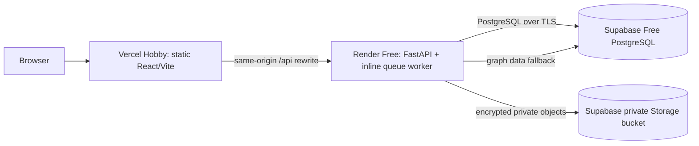

# No-charge hosted deployment guide

This guide prepares a $0 demonstration deployment for the user-selected Vercel, Render, and Supabase stack. Provider dashboards and public URLs were checked on 13 November 2026. The Vercel Hobby project `rsiacdp-frontend` is live at `https://rsiacdp-frontend.vercel.app/` and its home page returns HTTP 200. Its `/api/health/live` route returns HTTP 404 because the Render API is not deployed. The existing Supabase Free project was observed healthy in Tokyo (`ap-northeast-1`); its dashboard overview showed no migrations, and its `private-evidence` bucket was private. Render has no services or environment groups. Starting its Blueprint flow displayed an identity-verification requirement for a payment card and a temporary USD 1 authorization; the flow was canceled without entering a card or creating a service. The direct Render health routes also return HTTP 404. No provider secret values were read or copied, and no database migration was run. Do not start a paid trial, select a paid plan, attach a persistent disk, add Neo4j to Render, or enter a payment card. The Render deployment is blocked under the no-card constraint; if a provider blocks its Free flow until billing information is added, stop and do not continue.

## Current deployment state — 13 November 2026

| Component | Observed state | Verification boundary |
| --- | --- | --- |
| GitHub | Branch `codex/initial-platform` is pushed through `cb09da0`. | Latest hosted CI for this revision passed all six jobs: [run 43287764588](https://github.com/gaurvit06/RSIACDP/actions/runs/43287764588). |
| Vercel frontend | `https://rsiacdp-frontend.vercel.app/` responds HTTP 200. | Confirms static page delivery only; it does not establish a working authenticated API workflow. |
| Vercel API rewrite | `/api/health/live` responds HTTP 404. | Expected while its configured Render destination has no deployed service. |
| Render backend | No service exists; `/health/live` and `/health/ready` on the planned hostname return HTTP 404. | Blueprint onboarding was canceled when card verification and a temporary USD 1 authorization were required. No card was entered and no resource was created. |
| Supabase | Existing Free project observed healthy in Tokyo; `private-evidence` bucket's Public switch was off. | The dashboard overview showed no migrations and no backups. The database schema and migration state were not verified by querying `alembic_version`; do not infer them from the overview. |

The hosted application is therefore **not deployed end to end**. Do not submit real investigation data to the Vercel site until the API, persistence, private storage, and required hosted checks are available.

This architecture can run the application without paid services, but it is not a safe production home for real investigation evidence. Free services can pause, restart, lose local files, and lack managed database backups. Use synthetic or otherwise authorized low-risk evidence until an approved backup, privacy, and availability plan exists.

## Architecture



- **Vercel Hobby** serves the static frontend. This plan is limited to personal, non-commercial use under Vercel's terms. Use the generated `*.vercel.app` domain; do not buy a custom domain for this setup. [Vercel Hobby plan](https://vercel.com/docs/plans/hobby) · [Vercel terms](https://vercel.com/legal/terms)
- **Render Free Web Service** serves FastAPI and runs one supervised worker thread inside the same process. Render Free does not support separate background workers, persistent disks, or pre-deploy commands. A Free web service sleeps after 15 minutes without inbound traffic, may restart, has an ephemeral filesystem, and uses 0.1 CPU / 512 MB RAM. A request wakes it, which can take about a minute. Free instance hours and bandwidth/build quotas are shared by the workspace. [Render Free limits](https://render.com/docs/free) · [Render Blueprint specification](https://render.com/docs/blueprint-spec)
- **Supabase Free** is the durable system of record and private object store. The published quotas are 500 MB database, 1 GB Storage, and 5 GB egress; inactive projects can pause after one week. Free does not include automatic database backups or PITR. [Supabase pricing](https://supabase.com/pricing) · [Supabase billing documentation](https://supabase.com/docs/guides/platform/billing-on-supabase)
- **Neo4j is disabled in the default hosted profile.** Campaign links and the graph screen are served from persisted PostgreSQL records, which is already a supported fallback. This avoids putting normalized personal identifiers into another service and avoids the paid Render Neo4j service and disk. The local Compose profile still provides Neo4j for full local integration testing.
- **Supabase Free has no backup guarantee.** Do not use this free deployment for real investigation evidence until independent encrypted backups and restores are established. Provider limits can change; check the linked provider pages and the account dashboard on the day of setup.

## What the Blueprint creates

The root `render.yaml` is intentionally limited to exactly one service: `rsiacdp-api`, a Docker Web Service on the Free plan in Singapore. It builds from `backend/Dockerfile`, keeps uploads in Supabase Storage, and sets `RUN_INLINE_WORKER=true`. It does not define a Render database, paid worker, private service, Neo4j service, disk, or `preDeployCommand`.

The API applies the checked-in Alembic migrations during startup. PostgreSQL is still authoritative. The inline worker polls the durable PostgreSQL queue, handles source checks/processing/retention, and can be stopped gracefully. If a Render restart interrupts work, a stale processing job becomes eligible for retry after the worker's existing 10-minute stale-job threshold; the next API request wakes a sleeping Free service.

## Exact environment variables

`render.yaml` declares these values. `generateValue: true` uses Render's base64-encoded random 256-bit value format, which is valid for the application's JWT, 32-byte upload encryption key, and bootstrap-code checks. Render's Blueprint docs describe this generated format. [Render environment variables](https://render.com/docs/configure-environment-variables)

| Variable | Required value/source | Purpose |
| --- | --- | --- |
| `APP_ENV` | `production` (Blueprint) | Enables production validation. |
| `RUN_INLINE_WORKER` | `true` (Blueprint) | Runs the durable worker with the API for the Free single-service plan. |
| `UPLOAD_STORAGE_BACKEND` | `supabase` (Blueprint) | Uses shared durable private object storage. |
| `SUPABASE_STORAGE_BUCKET` | `private-evidence` (Blueprint) | Private evidence bucket name. |
| `SUPABASE_URL` | Supabase project HTTPS origin; enter in Render's protected secret prompt | Backend Storage API origin. |
| `SUPABASE_SERVICE_ROLE_KEY` | Supabase service-role secret; enter only in Render | Backend-only Storage access. Never put it in Vercel or frontend code. |
| `DATABASE_URL` | Supabase **Session pooler** connection string, using `postgresql+psycopg://` and `sslmode=require`; enter only in Render | PostgreSQL system of record. Copy the pooler host and username from Supabase Connect; percent-encode reserved characters in the password. Do not use transaction-pooler port 6543. [Supabase connection guide](https://supabase.com/docs/guides/database/connecting-to-postgres) |
| `WEB_ORIGIN` | Exact Vercel production origin, e.g. `https://rsiacdp-frontend.vercel.app`; enter in Render | CORS allowlist and secure-cookie origin. No trailing slash or path. Do not use a Preview URL. |
| `JWT_SECRET` | Generated by Render Blueprint | Signs authenticated sessions. |
| `UPLOAD_ENCRYPTION_KEY` | Generated by Render Blueprint | AES-GCM encryption key for uploaded files. Back it up separately in an approved secret manager; losing it makes stored uploads unreadable. |
| `INITIAL_INVESTIGATOR_CODE` | Generated by Render Blueprint | Bootstrap code for the first investigator account. |
| `INITIAL_REVIEWER_CODE` | Generated by Render Blueprint | Separate bootstrap code for the reviewer account. |
| `DATA_RETENTION_DAYS` | `180` (Blueprint; change only to the approved retention period) | Application retention sweep policy. The inline worker must be awake to run scheduled cleanup. |
| `RDAP_ENABLED` | `false` (Blueprint) | Keeps external domain lookups disabled by default. |
| `FORWARDED_ALLOW_IPS` | `127.0.0.1` (Blueprint) | Keeps unverified proxy headers untrusted. Request-address throttles may therefore share Render's proxy peer; do not change this to `*`. |

The following listed dashboard variable is **unused and incorrect**: `ADMIN_REGISTRATION_CODE`. The application reads `INITIAL_INVESTIGATOR_CODE` and `INITIAL_REVIEWER_CODE`; remove `ADMIN_REGISTRATION_CODE` from any manually created Render environment group. Render preserves existing values omitted from a Blueprint, so check the dashboard if you created an environment group before the service.

The following do not need to be set for this Free deployment. If any are already present in a Render service or environment group, remove them before relying on the PostgreSQL graph fallback:

- `NEO4J_URI`, `NEO4J_HOST`, `NEO4J_USER`, `NEO4J_PASSWORD`, and `NEO4J_PASSWORD_SLASH_SAFE`: the application uses the PostgreSQL-derived graph fallback when Neo4j is unconfigured.
- `ACCESS_TOKEN_MINUTES`, `PASSWORD_RESET_TOKEN_MINUTES`, login/registration/correction throttle values, campaign threshold, upload limit, RDAP timeouts, and RDAP response limit: code defaults apply unless an operator deliberately overrides them.
- `VITE_API_URL`: leave it unset/empty. The frontend sends requests to relative `/api/...` paths through the Vercel rewrite.
- `ADMIN_REGISTRATION_CODE`: not read anywhere in the application.

## Supabase database and Storage preparation

The migration chain is linear, with no branches:

```text
8099cf8152eb
  -> 748ef602ab07
  -> 5e2a74d9f31c
  -> 8f35d5a2b6c1
  -> a63b9d024ae1
  -> c42a7a34d781
  -> d1c77aa03521
  -> e31b2b999d0f
  -> f02d1c4a8910
  -> a8e20c5d1415
  -> b6a6c0192de4
  -> c96cc6d17573
  -> d84f8a1a5301
  -> 9a4c1e7d2b60
  -> a7b13c9e4d20
  -> f19c7b2a8d45
  -> c28f4e6a1b93
  -> e7a91c0d4b62 (head)
```

The migrations use standard PostgreSQL tables, columns, indexes, foreign keys, and JSON values. They do not install extensions or manually create Supabase-managed objects. The API executes `alembic upgrade head` at startup; do not manually recreate app tables in the Supabase SQL editor. Alembic's version table makes a completed upgrade repeatable.

Before the first deployment, inspect the existing project using the Supabase SQL editor. Confirm whether `public.alembic_version` exists and list the existing `public` tables. If this is a fresh database with no application tables, startup will apply the chain. If application tables already exist without a matching Alembic version, or the version is not in the chain above, stop and reconcile the schema first; do not drop tables or use `stamp head` to bypass migration checks. The owner should retain an approved database export before any schema change.

Confirm the existing Storage bucket is named `private-evidence`, is **not public**, and permits at least 11 MiB per object (the app allows 10 MiB plaintext and adds a small encryption envelope). If MIME restrictions are enabled, permit `application/octet-stream`; the API checks the original PDF/PNG/JPEG/WEBP content before storing it. Keep the service-role key only in Render.

## Dashboard setup steps (approved free-tier rollout)

The project owner explicitly approved pushing and proceeding with this hosted free-tier deployment on 13 November 2026. Use the existing Vercel Hobby workspace and Supabase Free project, create the frontend project after the owner completes Vercel's step-up verification, and create only the single Free Render Web Service described above. Render is configured for Singapore while the existing Supabase database is in Tokyo, so database calls cross regions and may add latency. Stop if a provider requires a paid tier, paid trial, persistent disk, or payment card. Keep all provider secrets inside the protected provider settings; do not commit or send them in chat.

1. In Vercel, confirm `rsiacdp-frontend` is on the Hobby plan and is used only for personal/non-commercial work. Set Root Directory to `frontend`, production branch to `codex/initial-platform`, and use the generated `.vercel.app` hostname. Do not start a Pro trial or add a paid domain.
2. In Render, connect `gaurvit06/RSIACDP`, branch `codex/initial-platform`, and use the root `render.yaml` Blueprint. Verify the plan says **Free** and exactly one Web Service will be created before applying. Region is Singapore in the Blueprint and cannot be changed after service creation.
3. At the Blueprint's `sync: false` prompts, enter the Supabase URL, session-pooler `DATABASE_URL`, Supabase service-role key, and exact Vercel production `WEB_ORIGIN`. Never paste these values into chat, GitHub, or a frontend variable. If Render asks to upgrade or add a payment method, cancel the flow.
4. Confirm the generated `JWT_SECRET`, `UPLOAD_ENCRYPTION_KEY`, and two bootstrap codes appear only in Render's protected environment settings. Use the investigator and reviewer bootstrap codes to create separate accounts; do not publish them.
5. In Vercel, confirm Root Directory is `frontend`, branch is `codex/initial-platform`, install command is `pnpm install --frozen-lockfile`, build command is `pnpm run build`, and output directory is `dist`. Keep `VITE_API_URL` empty. `frontend/vercel.json` rewrites `/api/*` to `https://rsiacdp-api.onrender.com/api/*`, matching the Render service name.
6. Verify the deployed URL, login, consented synthetic text case, PDF/image upload under the size limit, worker completion, local evidence lookup, evidence timeline, campaign links, PostgreSQL-derived graph, redacted report, correction request, retention behavior, and unauthenticated denial of a private Storage object. Confirm both Vercel `/api/health/ready` and the direct Render `/health/ready` respond as expected.
7. Check both Vercel and Render paths for spoofed `X-Forwarded-For`. Keep proxy trust loopback-only unless the actual peer chain is verified and direct-origin bypass is addressed. Do not rely on per-client throttles while all requests map to a shared proxy peer.
8. Recheck dashboard plan/usage and confirm no paid service, trial, custom domain, persistent disk, or payment method was activated. Free quotas may suspend service instead of charging only when no payment method is on file; provider account behavior must be checked directly.

## Checks and known limitations

Before deployment, run these repository checks from PowerShell:

```powershell
cd backend
python run_ci_tests.py
cd ..\frontend
pnpm install --frozen-lockfile
pnpm run build
pnpm run test:redaction
cd ..
.\scripts\test-compose-config.ps1
```

Run the commands from the repository root in order. Do not run real evidence through tests. Supabase connection, bucket permissions, provider quotas, public TLS/cookies, and the Vercel-to-Render proxy cannot be verified from this local repository alone.

This free setup is best-effort: Render can cold-start slowly, restart at any time, and suspend when quotas are exceeded; inline OCR shares 512 MB with the API; queued work resumes only when the service wakes; Supabase Free can pause for inactivity and has no automatic backup/PITR; Neo4j is not deployed; and Vercel Hobby is personal/non-commercial only. Use synthetic cases for the hosted review. Do not use this configuration as the sole store for real investigation material.
