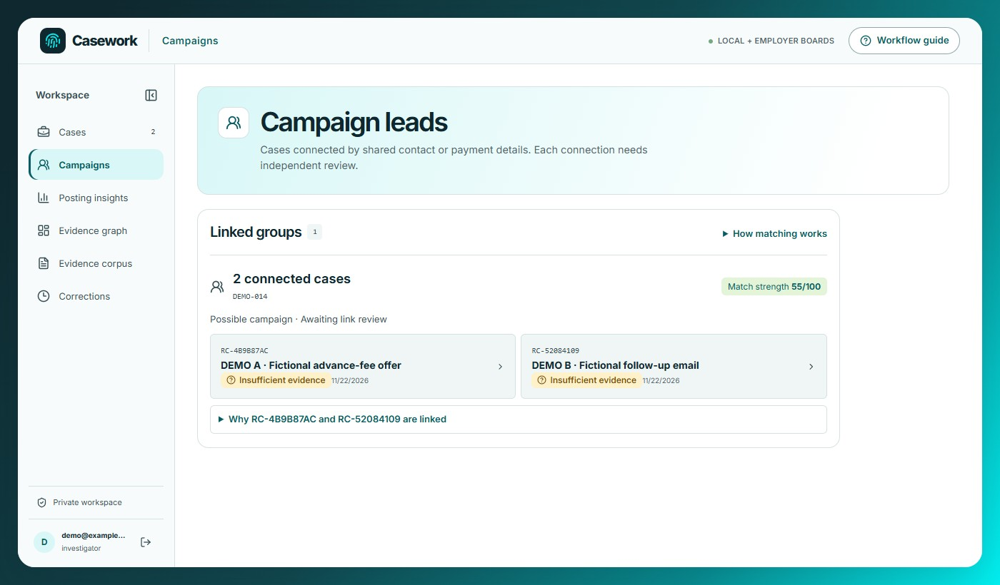

# Casework · Recruitment Scam Investigation and Campaign Intelligence Platform

Casework helps an investigator answer three questions about a job offer. **What does the message say? What can a source verify? Where has the same identifier appeared before?** A student can follow one fictional offer from submission to a source-backed finding, a graph connection and a downloadable report.

**[Open Casework on the web](https://rsiacdp-frontend.vercel.app/).** Choose **Explore a sample case** for the public example. The private investigator workspace requires a login supplied separately by the project owner. The [hosting guide](HOSTING.md) describes the deployment and how to check its health.

## Run it locally

Install Git, Docker Desktop with Linux containers (Compose 2.24.4 or later), and PowerShell 7.1 or later. Start Docker Desktop. The first build needs internet access to download images and dependencies. No cloud account, LLM key or training dataset is required.

On a **new computer**, open PowerShell and run:

```powershell
git clone https://github.com/gaurvit06/RSIACDP.git
cd RSIACDP
pwsh -File scripts/local.ps1 -Action Init
pwsh -File scripts/local.ps1 -Action Rebuild
pwsh -File scripts/local.ps1 -Action CreateInvestigator
```

Choose your own email and password when prompted. Open [Casework on localhost](http://localhost:5175/) and choose **Sign in**. On the **existing demonstration computer**, start Docker Desktop, run `pwsh -File scripts/local.ps1 -Action Start`, and sign in with the existing account. The saved cases are in that installation’s PostgreSQL volume. A fresh clone includes the fictional demo materials and starts with an empty private workspace.

## A five-minute demonstration

| Step | What to do | What to look for |
| --- | --- | --- |
| 1. Read the offer | After signing in, open the [vacancy walkthrough](http://localhost:5175/#vacancy-demo). Compare the JL-204 email with the linked fictional employer register. | Both name the same vacancy contact. The example works offline once the application is built. |
| 2. Follow the evidence | Consent and select **Create training case**. Once processing finishes, choose **Confirm email and mark source relevant**, then **Show case connections**. | The corpus supplies a source, excerpt and retrieval time. The graph shows which evidence checked which identifier in this case. |
| 3. Find a possible campaign | Open **Cases → New case** twice. Paste the [sample message](demo/offer-message.txt) as a message and the [sample email](demo/offer-email.eml) as an email. Use separate titles, give consent and wait for completion. Confirm the shared email in both cases, choose **Recompute links** in a case and open **Campaigns**. | Two different submissions reuse the same mailbox. Inspect the link reason and the rule that produced it. |
| 4. Take the result away | Open one case, inspect the fee wording and its source location, then download the Markdown report. | The report brings together the finding, supporting records and review trail with personal identifiers masked by default. |



For the existing demonstration cases, OCR with a screenshot or scanned PDF, and the full feature checklist, see the [presenter’s walkthrough](FEATURE_WALKTHROUGH.md).

## How to read the results

| Output | Question it answers | How to interpret it |
| --- | --- | --- |
| **Model decision** | Does the posting resemble higher-risk examples? | The bundled Hiring Market logistic regression uses 5,000 TF-IDF features and ten numeric inputs. Scores from 0.35 receive **Higher fraud risk**. Fewer than three distinct recognized words produce **More posting text needed**. |
| **Evidence finding** | What supports this specific claim? | A payment request can be traced to the submitted words. A vacancy publication can be corroborated against a configured employer board. **Insufficient evidence** means the available checks could not establish the claim. |
| **Campaign link** | Do separate cases share identifiers? | An exact mailbox match can create a lead. Open the edge to inspect the reason. Identifying a sender or establishing wrongdoing requires separate evidence. |
| **Human disposition** | What did the investigator conclude? | The application keeps the investigator’s rationale, supporting evidence and review history separately. |

A copied advert can match a real vacancy. Confirmation of its publication leaves the identity of the sender and the terms of an individual offer unresolved. Independent accuracy on Indian recruitment offers remains unmeasured. The posting model is adapted from the [Hiring Market Analysis project](https://github.com/Sumersingpatil2694/Fake-Job-Detection-And-Hiring-Market-Analysis). Casework adds mixed-format intake, claim-level provenance, deterministic case linking and investigator review.

## Where to look in the repository

| Start here | Contents |
| --- | --- |
| [Frontend](frontend/src/) | React and TypeScript investigator workspace, public sample and vacancy walkthrough |
| [Backend](backend/app/) and [migrations](backend/migrations/) | FastAPI, the processing worker, posting model, evidence rules, PostgreSQL records and rebuildable Neo4j graph |
| [Engineering walkthrough](ENGINEERING_WALKTHROUGH.md) | Step-by-step implementation, design decisions and pointers to the owning code |
| [Local operations](LOCALHOST.md) | Startup, accounts, ports, troubleshooting and encrypted backup and recovery |
| [Demo files](demo/) | Fictional messages, screenshot, searchable and scanned PDFs, and the vacancy register |
| [Evaluation](backend/evaluation/README.md) | Synthetic fixtures, time-separated evaluation, baselines, scoring and limitations |
| [Verification](BUILD_STATUS.md) and [CI](.github/workflows/ci.yml) | Submission checks and automated tests for the application and recovery workflows |
| [Source access](SOURCE_ACCESS_REVIEW.md) | Data-source provenance and access limits, including I4C |
